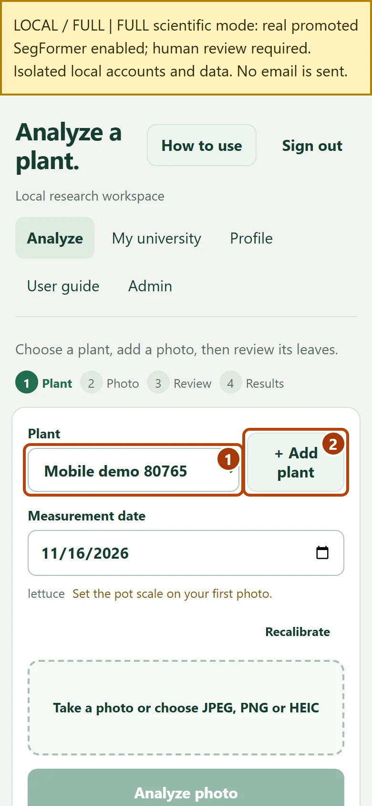
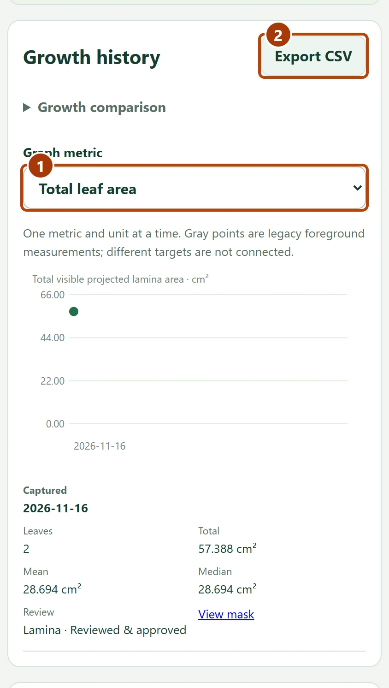
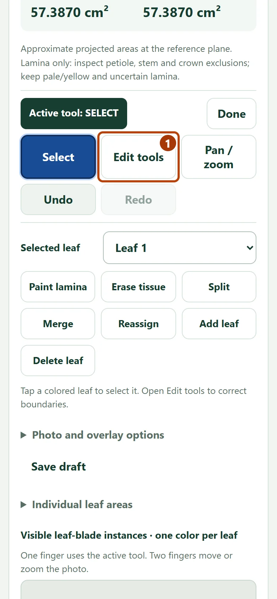
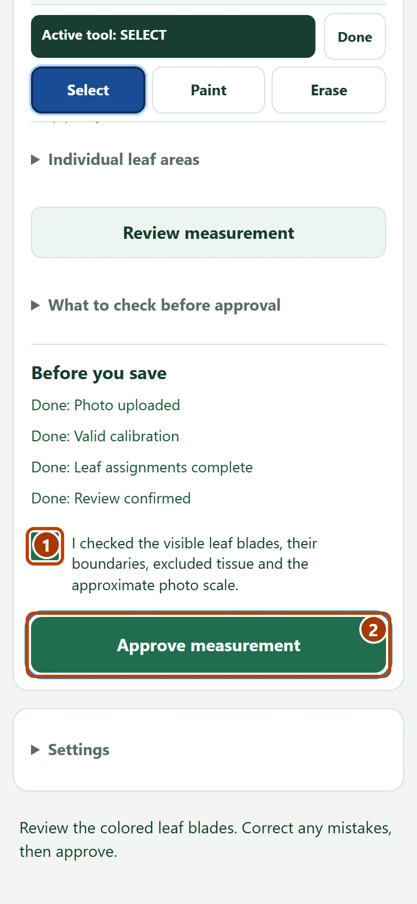
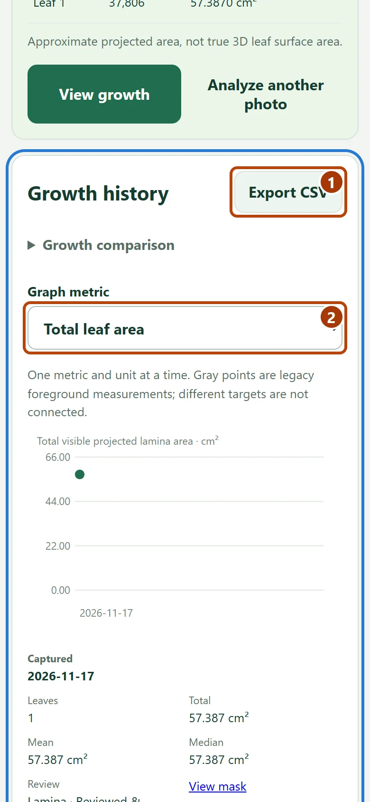

# iPhone ile adım adım Leaf Research

Her görüntü gerçek uygulamanın 390 piksel genişliğindeki telefon görünümüdür. Görüntüye dokunarak büyütün. Örnekler yalnızca yapay bir bitki ve yerel deneme hesabıyla hazırlanmıştır; araştırma verisi değildir. Safari'nin Photo Library menüsü ve iCloud ekranı iOS'a göre değişir; burada uygulamanın kendi ekranları gösterilir.

Analyze ekranındaki yedi adım gerçek duruma göre ilerler; analiz veya onay kendiliğinden başlamaz. Üstteki kısa yönlendirmeyi ve ana düğmeyi izleyin. **Hide tips / Show tips** ile isteğe bağlı ipuçlarını kapatıp açabilirsiniz; bitmiş adımlar düzenlenebilir kalır.

## 1. Sign in — giriş yapın

Kendi e-posta adresinizi (1) ve şifrenizi (2) yazın; **Sign in** (3) düğmesine dokunun. İstenirse e-postanızı doğrulayın; kurum erişimi için yönetici onayı da gerekir.

## 2. Bitkiyi seçin veya ekleyin

**Plant** (1) listesinden bitkinizi seçin; yeni bitki için **+ Add plant** (2) ile adını ve türünü girip **Add plant** düğmesine dokunun.

## 3. Photo Library'den fotoğraf seçin

İşaretli **Take a photo or choose JPEG, PNG or HEIC** alanına dokunun; iPhone menüsünden **Photo Library** ve fotoğrafınızı seçin. Saksının dış kenarı tam görünür, net ve tepeden çekilmiş bir JPEG, PNG veya HEIC/HEIF fotoğraf kullanın; ölçüm tarihini kontrol edin.

## 4. Saksı ölçeğini kaydedin

**4a — Çap:** Cetvelle ölçtüğünüz saksı DIŞ çapını santimetre olarak **Pot outer diameter (cm)** (1) alanına yazın. Görseldeki 12 cm yalnızca örnektir.

**4b — İlk nokta:** Fotoğrafta saksının dış kenarındaki ilk noktaya dokunun (2); yaprak sınırını veya iç kenarı seçmeyin.

**4c — Karşı nokta:** Merkezden geçen çapın karşı DIŞ kenarına dokunun (3); iki işaretçi arasındaki çizgiyi kontrol edin.

**4d — Kaydet:** Aşağı kaydırıp **Save calibration** (4) düğmesine dokunun. İşaretçiyi sürükleyerek veya **Undo last point** ile düzeltebilirsiniz.

Eğik, gizli veya kırpılmış saksı kenarıyla ölçek kurmayın; fotoğrafı yeniden çekin. Kamera konumu, yakınlaştırma, kadraj veya saksı değiştiğinde yeniden kalibre edin. Ölçek doğrulanamıyorsa **Review leaves first (pixels only)** ile yaprakları inceleyip kalibrasyonu sonra tamamlayabilirsiniz; önceki onaylı ölçümler değişmez.

## 5. Analyze photo — analizi bekleyin

**Ready to analyze** durumunda **Analyze photo** (1) düğmesine dokunun; **Analyzing** sırasında sayfayı açık tutun. Sunucu ilk kez açılıyorsa birkaç dakika sürebilir; bu, fotoğraf hazırlama hatasından ayrıdır.

## 6. Yaprakları kontrol edin ve düzeltin

**Colored leaves** (1) ve **Original photo** (2) ile fotoğrafı karşılaştırın. Görünen her yaprağın ayrı bir rengi olmalı; görünmeyen dokuyu boyamayın.

Gerekirse **Paint** veya **Erase** ile sınırı düzeltin; **Leaf corrections** altında **Split** (1), **Merge** (2) ve **Add leaf** (3) gibi yaprak düzeltmeleri bulunur. Etkin aracın kısa açıklamasını izleyin.

- **Split:** Bir yaprağı seçip ikiye ayıran bir çizgi çizin.
- **Merge:** Aynı yaprağın parçalarını seçip **Merge selected leaves** ile birleştirin.
- **Reassign:** Doğru yaprağı seçip aktarılacak alanı boyayın.
- **Add leaf:** Eksik görünen yaprağı boyayarak yeni yaprak oluşturun.
- **Delete leaf:** Kimliği kaldırır; kalan dokuyu yeniden atayın veya gerçekten yaprak değilse silin.
- **Undo / Redo:** Düzeltmeyi geri alın veya yineleyin. İki parmakla fotoğrafı taşıyıp yakınlaştırın.
- **Save draft:** Onaylamadan ara kaydı saklar. Geri döndüğünüzde aynı bitkiyi seçip **Resume unfinished review** kullanın.

## 7. Ölçümü onaylayın

**Review measurement** ile tamamlama listesine geçin. Yaprak sayısını, alanları ve ölçeği kontrol edip inceleme kutusunu (1) işaretleyin; **Approve measurement** (2) düğmesine dokunun. Eksik bir madde varsa **Return to leaf editor**, **Review calibration** veya **Review confirmation** düğmesiyle düzeltin. İnsan onayı zorunludur; piksel olarak kaydedilen bir ölçüm cm² diye gösterilmez.

## 8. Büyüme geçmişi ve CSV

Onaydan sonra **View growth** ile geçmişe veya **Analyze another photo** ile yeni fotoğrafa geçin. Bitkinin **Growth history** bölümünde **Graph metric** (2) ile grafik ölçütünü seçin; **Export CSV** (1) ile geçmişi indirin. Aynı ölçüm hedefini ve tutarlı çekim koşullarını karşılaştırın.

## Alanın anlamı

Fotoğraf → otomatik yaprak önerisi → insan kontrolü → piksel sayımı → doğrulanmış kalibrasyon → onaylı büyüme geçmişi.

İncelenen piksel sayısı × (santimetre/piksel)², saksı kenarı düzlemindeki yaklaşık izdüşüm alanını verir. Doğrulanmış ölçek yoksa alan piksel olarak kalır. Bu gerçek 3B yaprak yüzey alanı değildir; örtüşen veya gizli doku tek fotoğraftan ölçülemez. Otomatik maske ground truth değildir; deneyiniz için bağımsız gerçek ölçümlerle doğrulayın.

## Sorun olursa

- **Fotoğraf hazırlanamadı:** Ekrandaki nedeni okuyun; fotoğraf seçili kaldıysa **Try again** kullanın veya fotoğraf seçme alanına dokunarak başka fotoğraf seçin. Bitkiyi yeniden oluşturmanız gerekmez. HEIC açılamıyorsa fotoğrafı JPEG olarak dışa aktarıp seçin.
- **Analiz uzun sürüyor:** İlk sunucu açılışını bekleyin; hata sonrası **Resume unfinished review** ile tamamlanıp tamamlanmadığını kontrol edin.
- **Bağlantı kesildi:** Bağlantıyı düzeltip ekrandaki yeniden deneme eylemini kullanın; sayfayı yenilemeden başka fotoğraf seçebilirsiniz.
- **Oturum sona erdi:** Yeniden giriş yapın, aynı bitkiyi seçin ve kaydedilmiş incelemeyi açın; henüz sunucuya ulaşmamış bir fotoğrafı yeniden seçmeniz gerekebilir.
- **Kalibrasyon eksik:** DIŞ çapı ve karşı DIŞ kenar noktalarını kontrol edin; yaprak incelemesi ile ölçek doğrulaması ayrı adımlardır.
- **Onay kaydedilemedi:** Taslağı saklayın; tekrar onaylamadan önce geçmişte tamamlanmış ölçüm olup olmadığını kontrol edin.

- **Aynı bitki ve tarihte kayıt var:** Önceki onaylı ölçüm değişmez. **Check photo date** ile fotoğrafın gerçek tarihini kontrol edin; tarih doğruysa geçmişteki mevcut kaydı inceleyin. Sadece onay alabilmek için tarihi değiştirmeyin.
