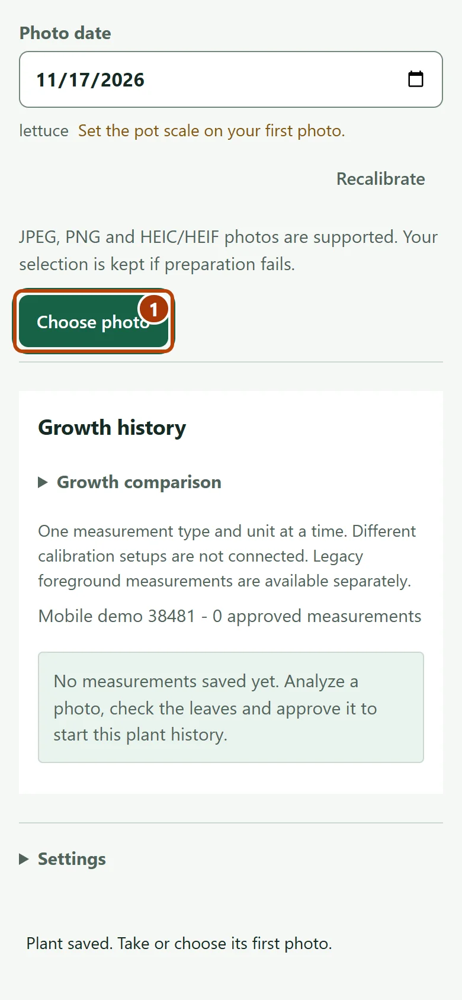
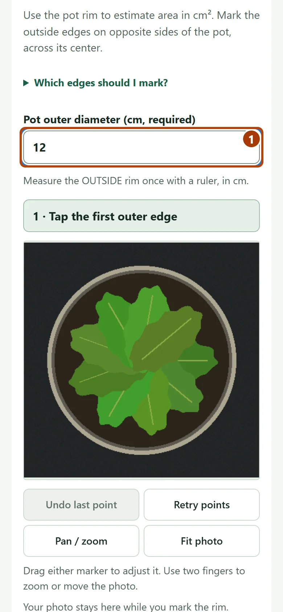
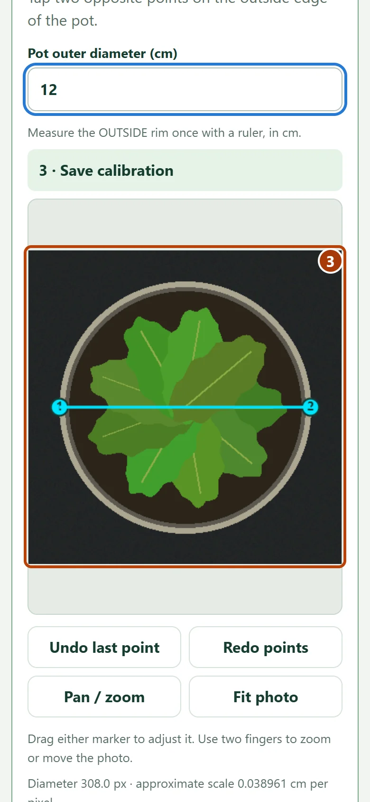

# How to use Leaf Research

Follow these seven steps, from a photo to reviewed growth results. Tap any screenshot to enlarge it; the pictures show an isolated demo with original synthetic artwork, not research measurements.

## 1. Select or add a plant

Sign in with your verified, approved account, then open Analyze a plant. Choose your plant (1), or tap + Add plant (2), enter its name and species, and save.

## 2. Upload an overhead photo

Tap the highlighted photo box to take or choose a JPEG, PNG or HEIC image. Use a sharp, evenly lit overhead photo with the whole plant and outer pot rim visible; check the capture date.

## 3. Calibrate the photo scale

If prompted, enter your pot's ruler-measured OUTER diameter in centimetres (1), tap two opposite outside-rim points across its centre (2), then Save calibration (3). The pictured 12 cm is only this demo's diameter; use your own measurement.

Drag a marker to correct it, or use Undo last point / Redo points; two fingers move or zoom. Reuse a valid scale only for the same pot and unchanged camera position, zoom and framing; recalibrate after changes or when unsure, and retake tilted photos or cropped rims.

## 4. Analyze the photo

Tap Analyze photo and keep the page open while the progress message runs. If the server has been idle, the first proposal may take 1?2 minutes, sometimes longer; it still needs your review.

## 5. Review and correct the colored leaves

Compare each colored leaf with the photograph; open Edit tools (1) and correct the overlay (2). Keep pale or yellow blades, exclude stalks, stems, crown, pot and background, and never paint hidden tissue.

- **Split:** Select one region containing two blades; draw a complete cut across it.
- **Merge:** Select pieces of one blade, then Merge selected leaves.
- **Reassign:** Select the receiving leaf; paint the pixels to transfer.
- **Add leaf:** Paint a missed blade, including unpainted areas; only the painted region changes.
- **Delete leaf:** Removes its assignment; reassign the remaining tissue or erase confirmed non-blade pixels.
- **Paint lamina / Erase tissue:** Correct the visible blade boundary, then assign any unassigned tissue.
- **Undo / Redo:** Reverse or reapply an edit. Two fingers move or zoom without painting.

## 6. Approve the reviewed measurement

Check the leaf count, individual areas, total, mean, median and scale; confirm the review checkbox (1), then tap Approve measurement (2). Only human approval finalizes the measurement; if approval is unavailable, read the displayed reason and correct the missing step.

## 7. View growth history and export

Select the plant to see its approved Growth history, and choose a Graph metric (1) to view total area, leaf count, mean or median. Tap Export CSV (2) to download the history; compare consistent photos and matching measurement targets.

## How the area is measured

Photo ? automatic detection ? individual leaf masks ? human review ? pixel counting ? calibration ? growth history.

Reviewed pixels ? (centimetres per pixel)? gives approximate square centimetres at the pot-rim reference plane. Without verified scale, areas stay in pixels; calibration can be completed after leaf editing, and new calibration never changes approved history.

This is visible projected leaf-blade area, not true 3D surface area. Hidden or overlapping tissue cannot be measured directly from one photograph; curved or raised leaves and uncertain calibration affect the result. Automatic proposals are not ground truth: validate reviewed measurements for your experiment.

## Troubleshooting

- **Analysis taking time:** The server may be starting; keep the page open. After an error, check Resume unfinished review before retrying.
- **Calibration required:** Check your OUTER pot diameter and the two opposite rim points; correct or recalibrate them.
- **Wrong number of leaves:** Inspect the colored regions and use Split, Merge, Reassign or Add leaf.
- **Approval unavailable:** Read the displayed reason and resolve unassigned tissue, scale or review confirmation. After a saving error, check for a recovered result before repeating approval.
- **Photo failed:** Use Retry photo; keep the same plant record.
- **Account pending:** Verify email when requested; an administrator must separately approve institutional access. This public guide does not grant access to research data.
