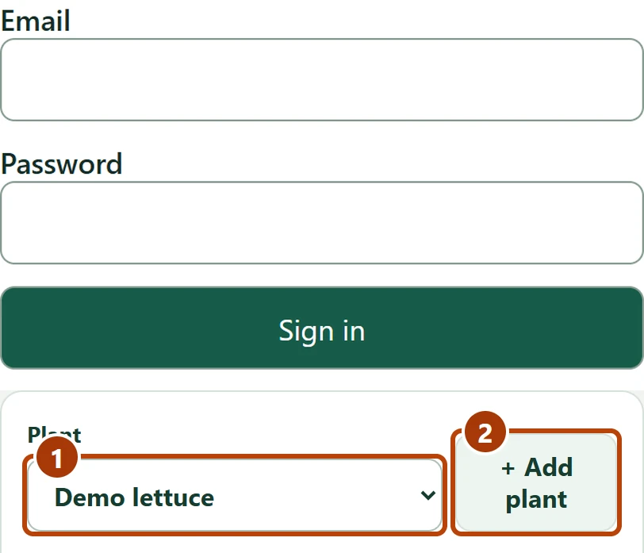
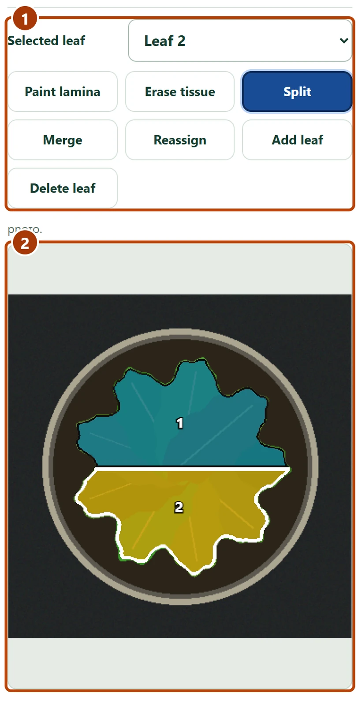
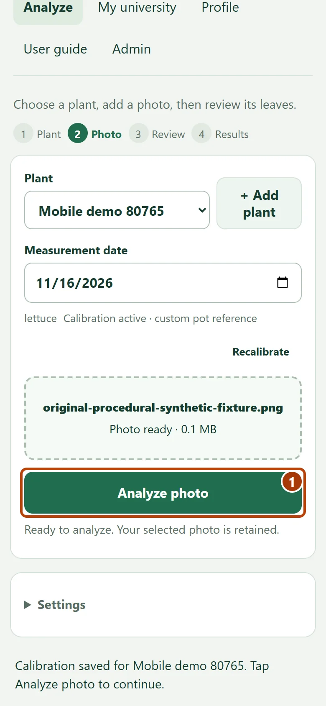
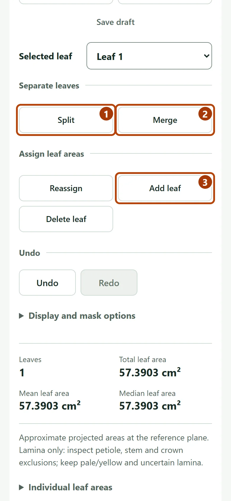

# How to measure a plant from your phone

These are actual phone-sized views of the application, using a synthetic plant and test account. Tap a screenshot to enlarge it. The Photo Library menu on your iPhone may look different.

Follow the instruction beside the current control. **View steps** opens the progress list; completed steps can be revisited. **Hide tips / Show tips** controls optional guidance. Analysis and approval always require your action.

## 1. Sign in

Enter your email (1) and password (2), then press **Sign in** (3). New users choose **Create account**, verify their email, and wait for institutional approval before analyzing plants.

## 2. Choose or add a plant

Choose your plant from **Plant** (1). For a new plant, press **+ Add plant** (2), enter its name and species, then save with **Add plant**.

## 3. Choose a photo

Press **Choose photo** (1), then choose **Photo Library** in the iPhone picker. Select a clear overhead photo of the whole plant with the full outer pot rim visible. Check **Photo date**. JPEG, PNG and HEIC/HEIF are supported.

## 4. Set the photo scale

**4a - Enter the diameter:** Measure the outside of the pot rim with a ruler. Enter that value in **Pot outer diameter (cm, required)** (1). The example 12 cm is not a value to copy.

**4b - First point:** Tap the first outside edge of the pot rim (2). Choose the outer rim, not the leaf boundary or inside edge.

**4c - Opposite point:** Tap the opposite outside edge (3), across the pot center. Check that the line spans the outside diameter.

**4d - Save:** Press **Save calibration** (4). Drag a marker or use **Undo last point** to correct it. **Retry points** starts the points again; pinch to zoom.

If **Pot diameter needed** appears, press **Enter pot diameter** and enter the measured value. Your selected points are kept.

Use a full, nearly circular rim in an overhead photo. A tilted, hidden or cropped rim needs another photo. Recalibrate if the pot, camera distance, zoom or crop changes; matching image dimensions alone do not verify physical scale.

If scale is unavailable, choose **Review without cm² for now**. You can inspect the leaves in pixels and complete calibration separately; pixel-only results are not reported as cm². Earlier approved measurements remain unchanged.

## 5. Analyze the photo

When **Photo ready** appears, press **Analyze photo** (1). Keep the page open while the status changes from uploading to analysis and review preparation. The first analysis may take several minutes while the service starts; this is separate from photo preparation.

## 6. Review the leaves

Switch between **Colored leaves** (1) and **Original photo** (2). Each visible leaf should have its own color. Correct mistakes before approving; do not paint tissue that is hidden or absent.

Use **Paint** and **Erase** for leaf boundaries. Open **Leaf corrections** for **Split** (1), **Merge** (2), **Reassign**, **Add leaf** (3) and **Delete leaf**. The active tool has a short instruction beside the image.

- **Select:** Tap a colored leaf to select it.
- **Split:** Select a leaf, then draw a line through it to divide it.
- **Merge:** Press **Merge**, select two or more leaf checkboxes in **Individual leaf areas**, then press **Merge selected leaves**.
- **Reassign:** Choose the correct leaf, then paint the area to transfer.
- **Add leaf:** Paint a missing visible leaf. Release to create its assignment.
- **Delete leaf:** Removes the assignment. Reassign the remaining tissue, or erase it if it is not leaf blade.
- **Undo / Redo:** Restore or repeat an edit. Use **Pan / zoom** or two fingers to move and zoom the photo.
- **Save draft:** Save without approving. Return to the same plant and choose **Continue previous review** to resume.

## 7. Approve the measurement

Press **Review measurement**. Check the plant, photo, leaf count, total, mean and median area, and scale status. Tick the review checkbox (1), then press **Approve measurement** (2). Human review remains required.

If approval is blocked, use the displayed repair action, such as **Return to leaf editor**, **Review calibration** or **Check photo date**. Resolve the stated problem before approving.

## 8. Growth history and CSV

After **Measurement saved**, press **View growth history**, or choose **Analyze another photo**. In **Growth history**, choose **Graph metric** (2) and use **Export CSV** (1) to download the saved measurements.

Growth needs measurements from additional dates. Compare the same measurement target and consistent capture conditions. Legacy foreground measurements remain separate from reviewed leaf-blade measurements.

## What the area means

The reviewed pixel count multiplied by the squared centimeters-per-pixel scale estimates visible projected area at the reference plane. Without verified scale, area remains in pixels. This is not true 3D leaf surface area; one photo cannot measure hidden or overlapping tissue. The automatic mask is a proposal, not ground truth. Validate your research measurements independently.

## Recover from a problem

- **Photo preparation failed:** Read the stated reason. Use **Try again** to retry the retained selection, or **Choose photo / Choose another photo** to reselect. You do not need to recreate the plant. **Copy error details** provides diagnostic text for support.
- **Analysis is taking time:** Keep the page open and follow the status. After a failure, retry or use **Continue previous review** to check the unfinished analysis.
- **Connection interrupted:** Restore the connection and use the displayed retry action. Keep the page open to retain local work.
- **Session expired:** Keep this page open. Use **Sign in in another tab** to sign in to the same account, then return and press **Reconnect**. The photo and unsaved edits remain in this open tab; do not refresh it.
- **Scale needs attention:** Enter the measured outside diameter and select the two opposite outside-rim points. Leaf review and physical scale verification are separate tasks.
- **A measurement is already saved for this plant and date:** Use **Check photo date** to verify the actual capture date, or inspect the saved history. Do not change the date just to bypass the duplicate check. Existing approved measurements stay unchanged.
- **Approval did not complete:** Read the error and check growth history before trying again. Save a draft when the connection permits.
